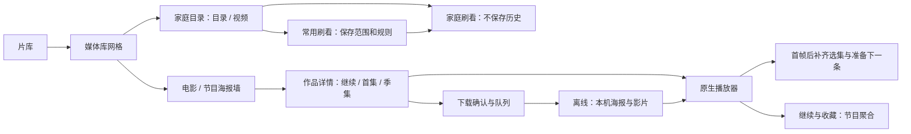

# Glide 1.1.0 功能规格

2026-10-09。对应[版本规划](Next-Version-Product-Plan-2026-10-09.md)。按以下范围实现，真机性能指标仍需验收。

| 功能 | 入口与主要流程 | 数据／异常规则 |
| --- | --- | --- |
| 常用刷看 | 家庭目录图钉保存当前范围／排序／顺序；首页卡片进入目录，独立播放键直接开刷；管理页可改名称与规则 | 使用现有固定目录 ID；旧数据按原目录偏好迁移；账号不匹配拒绝进入；随机必须先收齐范围；失效目录显示错误，不扩展到全库 |
| 浏览恢复 | 目录／视频各保存可见条目；进入子目录前保留分页快照；返回即时还原；刷新不清空已有网格 | 来源＋账号＋目录＋排序隔离；快照仅内存、有限容量；主动切换视图／筛选从顶部开始；异步代次校验；来源变更清理 |
| 节目继续观看 | 个人页一节目一卡片；显示季集和进度；节目详情增加直接继续／首集播放 | 按来源及 SeriesId 聚合；最近集未完成则续播，完成后找下一未看集；特别篇单独队列；记录移除仅隐藏本机；未知旧记录保留 |
| 下一条准备 | 当前首帧后且播放稳定时，只准备队列中下一条；本地或 Wi-Fi 可提前准备原生直放资产 | 不预开转码；只使用服务器明确可直放的响应；蜂窝／低电量／缓冲／背景取消；单条、短时有效、4 秒超时；切换时不等待尚未完成的预取 |
| 等待反馈 | 首帧前显示预览和轻量准备；首帧后只显示缓冲反馈，不卡住控制 | 保留现有自动兼容顺序和真实缓存区间；日志记录总耗时及准备命中；原生框架限制不伪装为预取保证 |
| 下载队列 | 加入队列后单任务下载；离线页分可播放／进行中／需处理；下载前说明版本、大小和格式 | 现有活跃任务保留；完成／失败／暂停后推进；重试新 ID 防旧回调；登录失效不无限重试；传输完成仍必须校验 |
| 离线快照 | 下载条目保存展示元数据与独立海报；离线页直接从沙盒加载 | 缺图可播放；移除来源默认保留已完成下载，用户可明确选同时删除；未完成任务停止；不保存授权 URL／令牌 |

保留现有手势：短点呼出、长按跳转、上下切视频／剧集、左右倍速、放大后拖动、锁定防误触。继续只用原生播放器，收费保持隐藏。批量下载、HLS 离线打包、全库搜索、照片和新平台不包含在本次实现。

验收覆盖旧记录迁移、账号与范围边界、节目聚合与跨季、随机完整性、返回位置与刷新失败、预取取消、离线队列与断网播放、现有播放器手势回归。结果另记测试报告，不将模拟器测试当作实机性能达标。

## 页面职责与操作路径

### 片库与常用刷看

主导航继续为「片库／继续与收藏／离线／设置」。片库主页保留媒体库网格，家庭媒体库的常用目录位于上方，仅显示当前来源的入口。常用卡片名称点击后浏览，右侧播放键按保存的规则开刷，不再让用户临时选择范围。图钉第一次保存时取当前设置；之后在目录中临时改排序，不覆盖已保存的常用规则。

管理页长按或向右滑进入编辑：名称、包含子目录、视频排序、顺序／随机四项。改名仅是本机显示名。旧图钉使用原 ID，不生成重复入口；旧规则为空时读取目录偏好。随机开刷先收齐选定范围，显示已收集数量，取消不会开始播放；顺序可先起播已加载条目，再补齐后续列表。

进入家庭目录后保留「目录／视频」分段选择，目录排序与视频排序独立。返回上级复用最多 8 个范围快照，每个快照限制 1200 条已加载内容；超过限额重新读取。滚动目标用条目 ID，避免视频插入导致按像素恢复错位。筛选或排序变化主动从顶部开始。失败时保留已有内容，提供重试；真正空列表才展示空状态。

### 节目与电影

节目详情把播放主按钮放在季集选择之前。无记录时播放当前展示季的首集；有记录时明确显示「继续 第 X 季 · 第 Y 集」或「播放 第 X 季 · 第 Y 集」。播放动作先创建包含已选集的队列，首帧后异步补齐全节目。补齐失败不停止当前播放，控制台的选集面板可重试。

个人页的继续观看按节目聚合，封面使用节目海报；一条卡片展示节目名、来源、季集、进度。完成一集后找后续未看集，跨季保持季／集数字顺序。已看标记与本机进度冲突时优先本机明确进度；特别篇与正片分开。所有已知正片都完成才显示「已看完 · 从头观看」，有漏看集则指向漏看集。长按可查看节目与全部集数。删除该节目历史会移除这一节目所有本机历史时间戳，收藏独立保留。

电影仍是单作品续播；已结束的电影不出现在继续观看。家庭刷看继续不写播放记录。声音、字幕与强制字幕使用现有语言偏好；文件的流索引不跨集复用。

### 播放等待与资源准备

首帧前用当前视频预览图与轻量进度提示，显示画面后撤掉预览。播放时间前进不作为视频已解码的证据，保留真实图层首帧检测与自动恢复。用户无需选择质量档位。

下一条准备在当前首帧后、正常 1 倍速稳定播放 1 秒启动，仅 Wi-Fi 或本地文件可用。一次最多一条 AVURLAsset，4 秒超时、30 秒有效。存在需处理的语言选择、已学到需转码的文件、低电量、蜂窝、当前缓冲或离开前台时跳过或取消。只协商和异步加载可直放资产；不实例化第二个播放中的 AVPlayer，不访问转码播放列表。切换只复用已经完成的准备，不等未完成请求。账号、地址与令牌变化使准备失效。`warmup_hit` 仅表示资产准备命中，不表示全片缓存或首帧性能达标。

### 离线

下载前确认原文件封装、大小与占用空间；默认版本 MP4／MOV／M4V 才能加入。队列按加入顺序，每次一个传输；完成传输进入校验，下一传输可开始。失败任务进入「需处理」，不会阻塞后续有效任务，也不会无限自动重试。暂停释放传输名额，继续或重试重新进入队尾；旧版本已运行的后台任务不强制中止。

离线页按「可播放／进行中／需处理」分组，海报保存在下载清单中（JPEG 小于 1 MB），不依赖可清除的媒体缓存。无海报时仍可播放。移除来源须选「保留已下载影片」或「同时删除离线影片」；前者停止未完成任务、移除该来源本机个人记录，但已完成文件仍可从离线页播放。服务器文件不受影响。

## 发布边界

本次交付可运行源码与测试清单，先由用户进行 NAS、实机、弱网与高码率验收后再发布。模拟器通过不等同于 4K／HDR／Dolby Vision、后台调度或首帧指标达标。新增可选字段允许旧记录直接解码；缓存资源与个人记录中不持久化播放授权地址。

## 导航关系

