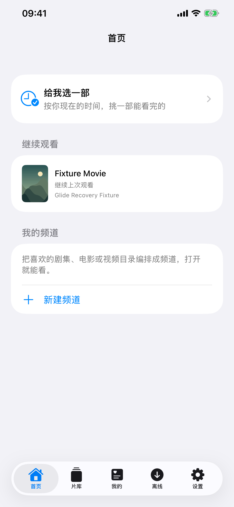
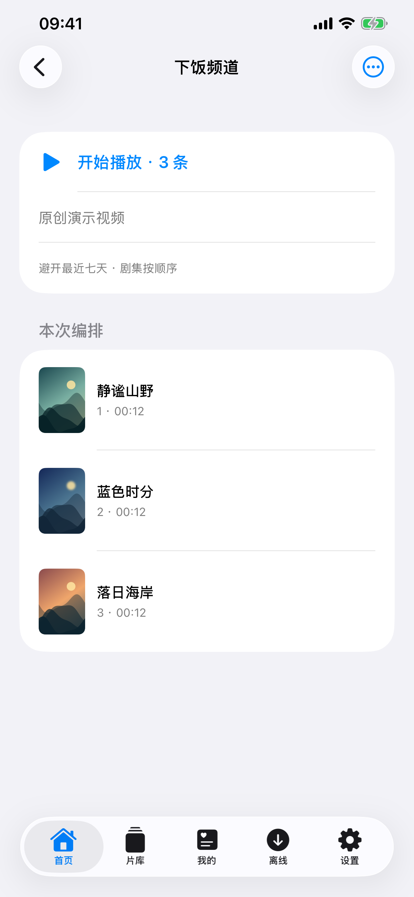
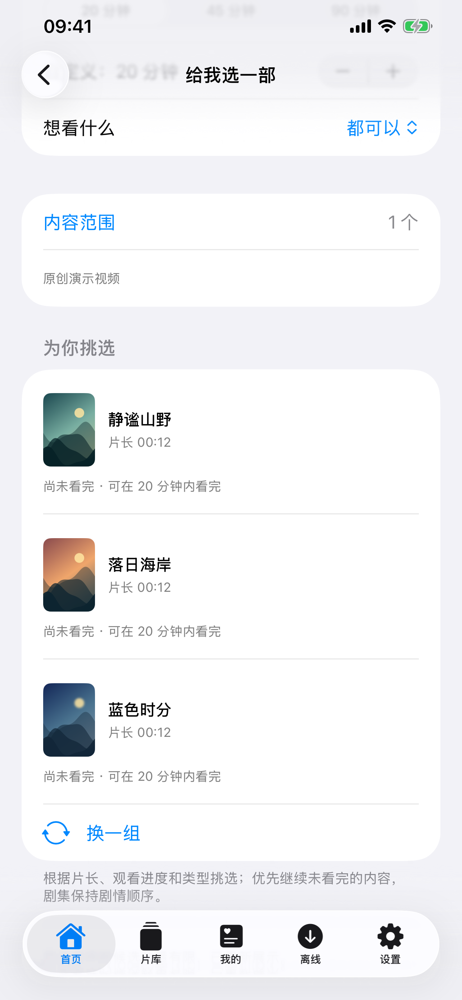
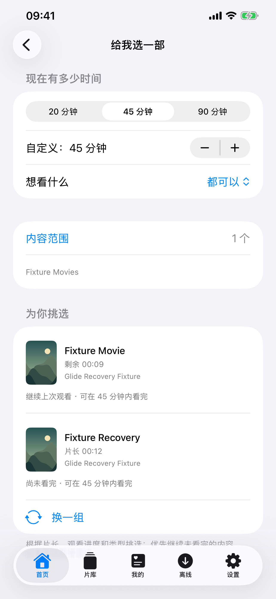

# Glide 1.10.0（1）：私人频道与时间选片

2026-10-22。最终开发包已安装到用户主应用 Glide；185 项核心测试、5 项模拟器界面回归、12 项实体机原创素材验证及 Release 归档检查均通过。实体机已恢复普通 Glide 界面。当前状态见 [Validation.json](Validation.json)。未推送、打标签或上传商店。

## 已实现

首页集中展示继续观看、给我选一部和我的频道，iPhone 使用原生五标签导航，iPad 增加首页侧栏入口。既有片库、我的、离线和设置继续保留。

私人频道可选择多个来源的媒体库、目录、剧集和单片，保存名称及编排规则。同一资源身份去重，各节目与普通视频组轮流播放，剧集依可用季集元数据排序；缺失元数据时以编排预览为准，不按片名合并不同服务器的文件。可排除已看完内容及最近七天开播的普通视频，未看完剧集保留继续观看，避免为去重跳过剧情。实际首帧出现后才记录频道开播，不把预览当作观看。频道模式固定编排，关闭文件级随机入口，复用生产播放器的自动下一条与原生控制。

时间选片支持 20／45／90 分钟及按五分钟递增的自定义时间，按照类型、完整／剩余片长和进度选择少量候选，显示来源和推荐理由。同一部剧只给出当前顺序中的下一可看集；候选不足时明确提示重新展示。范围单独保存，不改动用户片库的浏览位置。

频道存储使用独立可恢复快照，保存稳定来源和账号身份，不持久化临时播放 URL 或凭据。每次最多 16 个范围、5000 条视频和 500 个目录，本机最多 50 个频道、每频道 500 条开播记录。首页不自动遍历所有 NAS，范围准备可取消；来源不可用或超出限制时明确提示，不静默展示部分读取结果。

## 实际验证

| 项目 | 结果 |
| --- | --- |
| 核心 | 185 项通过：178 Swift Testing＋7 XCTest；新增 14 项覆盖跨来源节目身份、轮流编排、季集顺序、重叠范围去重、近期观看、时间预算、未知片长、续播、同剧下一集、类型过滤、持久恢复和账号绑定。见 [日志](Logs/Core-Final.log)。 |
| 最终界面流程 | 相同最终应用源码上 3 项通过，0 失败／跳过：频道创建／真实 EOF 自动换片／规则编辑／重启恢复；媒体服务器范围选择／强制分页／真实播放；时间／类型／范围／换一组／真实播放。见 [摘要](Discovery-Final-Controls-Summary.json)。 |
| 最终回归 | 2 项通过，0 失败／跳过：生产 PlayerView 的实际三视频频道自动推进与隔离存储验证；原有导航、菜单、浅色／深色／跟随系统设置。见 [摘要](Discovery-Final-Regression-Summary.json)。 |
| 实体机 | iPhone 13 Pro Max／iOS 27.0，最终包 1.10.0（1）的 12 项检查通过：使用原创素材，经生产 DiscoveryPlayer／PlayerView／AVPlayer 完成三段实际播放与 EOF 自动换片，核对剧集顺序、首帧开播记录及重载恢复、时间选片、频道编辑与删除。报告生成于 2026-10-22 16:52:37（北京时间）。已恢复普通 Glide。见 [脱敏报告](Discovery-iPhone-Final.json)、[成功启动](Logs/Device-Probe-Unlocked-Launch.log)、[恢复日志](Logs/Device-Normal-Launch.log)。此前锁屏失败的 [记录](Logs/Device-Probe-Launch.log) 保留。 |
| Release | 本地归档、deep／strict 签名、静态发布预检和应用／MobileVLCKit 实际 dSYM UUID 匹配通过。见 [预检](Release-Preflight.txt)、[签名](Release-Signature.txt)、[符号](Archive-Symbols.json)。归档在本机临时目录，尚未上传商店。 |
| 后续能力原型 | 九帧真实取图与离线画面分类已在 Mac 实验成功，不等于视频语义搜索、人物识别或 iPhone 性能验收。见 [原型记录](Prototype/README.md)。 |

模拟器为 iPhone 13 Pro Max／iOS 26.3.1。服务器用例使用本机回环的原创测试服务，完成后已停止；该结果不替代用户 NAS 的全格式、弱网和长播矩阵。本版没有重新执行所有历史字幕／4K／SMB 格式专项，也未完成实体机触控自动化。Release 只出现未依赖 AppIntents 而跳过元数据提取的提示，未关闭编译告警。

时间选片依赖可靠片长。媒体服务器采用其元数据，本地授权文件每次最多按需读取 200 条片长；未知片长会被排除并显示数量，不为读取片长下载完整 NAS 视频。剧集连续性依赖来源提供的节目、季和集信息。频道属于客户端编排，不是直播服务器或 IPTV 协议接入。

## 走查发现与修正

- 首轮频道测试误把已经合并的辅助功能文字节点当成容器，调整测试节点读取方式后继续验证，未改变视频顺序断言。
- 时间选片行以及首页入口的文字间隙曾未命中操作，补充完整行触控区域后实际播放通过。测试初始化也固定为原创演示范围，避免前一用例的来源状态影响启动。
- 频道规则开关的测试落点命中行标签，改为操作实际开关并核对值；随后规则修改及重启恢复通过。
- 下级范围页面原先丢失“完成”，现任意目录层级均有完成入口，作用于同一份范围选择并关闭整个选择页；服务器范围与完整分页随后通过。
- 早期失败批次均保留，不用最终通过覆盖历史：[初轮](Discovery-Initial-Summary.json)、[行触控修正](Discovery-Controls-Fix-Summary.json)、[频道规则复核](Discovery-Channel-Final-Summary.json)、[服务器与导航首轮](Discovery-Server-Native-Summary.json)、[下级完成修正](Discovery-Source-Final-Summary.json)。

## 已核对的界面

以下仅含原创素材与模拟服务器测试账号。完整实体机截图不纳入仓库。

[体验步骤](User-Acceptance.md)、[产品范围](../../Glide-1.10.0-Product-Plan-2026-10-22.md)、[发布说明](../../Glide-1.10.0-Release-Notes.md)、[源码指纹](Source-Snapshot.json)。实现沿用 [Apple NavigationStack](https://developer.apple.com/documentation/swiftui/navigationstack) 和 [AVAsset 异步加载](https://developer.apple.com/documentation/avfoundation/loading-media-data-asynchronously) 的平台能力，保持项目既有 iOS 17 起点。
