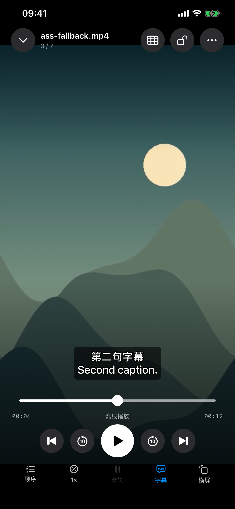

# Glide 1.11.0（2）：ASS 控制标签显示成正文修复

2026-10-22。用户报告《绝望主妇》第一季第一集出现字体、字号、颜色等 ASS 标签正文。本轮已安装修复包，在用户 iPhone 上验证该集，10 项检查通过；检查后恢复原字幕记忆并退出诊断回到普通 Glide。核心 202 项通过，原创界面用例在系统与兼容内核各完成一次真实播放验证。

## 原因和处理

实际来源返回两个轨道：ASS 与英文 SubRip。ASS 通过 Jellyfin 的 `Stream.srt` 交付给应用文字叠加层，转换结果仍含 ASS 覆盖块。原 `SubtitleCue.parse` 只移除 HTML 标签，因此字体、描边、颜色及样式重置标签会直接显示。

新增文字回退处理：识别并移除完整的 ASS 覆盖块，处理 `\N` 硬换行、按 `\q` 状态处理 `\n`，保留 `\h` 不换行空格。绘图模式中的矢量坐标不作为对白显示，`\p0` 或样式重置后恢复对白；不将 transform／clip 参数内部的绘图标记当作顶层状态。普通 SRT/VTT 中的花括号、路径与不完整文字不盲目清除；原编码为 ASS/SSA 时按 ASS 文本处理注释块。转换后仍标为 SubRip 但包含 ASS 控制块的情况也可识别。处理不改动 cue 时间。

本修复作用于应用的纯文字回退路线，使用应用现有文字样式，不代表完整还原 ASS 字体、颜色、定位、卡拉 OK 或动画。VLC 原生内嵌 ASS 和服务器烧录由其原渲染路线处理。本轮没有增加外挂 ASS 文件导入功能。

语法依据：[Aegisub ASS 标签规范](https://aegisub.org/docs/latest/ass_tags/)，核对换行、覆盖块和绘图语义。

## 实际结果

| 检查 | 结果 |
| --- | --- |
| 核心 | 202 项通过（195 Swift Testing＋7 XCTest），新增 6 项覆盖双语控制块、换行、绘图与重置、普通花括号／路径、不完整标签、时间及 Unicode 批量字幕。见 [日志](Logs/Core-Tests.log)。 |
| 原创界面 | 1 个流程用例通过、0 失败／跳过；内部依次运行 AVPlayer 和 VLC，确认实际首帧、中英叠加文本、拖动到第二句、绘图坐标不泄漏、关闭与重新开启。见 [摘要](ASS-UI-Summary.json)和[日志](Logs/ASS-UI.log)。 |
| 指定剧集真机 | iPhone 13 Pro Max／iOS 27.0、最终包 1.11.0（2），服务器原转换结果包含 ASS 覆盖块；707 条清理后字幕中，707 条包含中文，706 条多行，0 条残留控制块。定位到实际 16.180 秒时，生产叠加层显示中英对白，已从 Device Hub 屏幕预览确认。见 [脱敏报告](ASS-iPhone-Final.json)。 |
| 字幕与播放 | 10 项通过：实际原转换数据含标签、选择原轨道、整轨清理、保留中文多行、真实解码定位、当前时钟对应干净对白、关闭不重开视频、重开保持会话／时间／暂停、正文保持一致、继续同一视频会话播放。原两路字幕记忆已恢复，未上报观看进度。 |
| Release | 最终包归档、deep／strict 签名、应用与 MobileVLCKit 真实 dSYM UUID、发布预检均通过。见 [签名](Release-Signature.txt)、[符号](Archive-Symbols.json)、[预检](Release-Preflight.txt)。没有上传商店、提交、推送或打标签。 |

初次启动被 iOS 锁屏拒绝，保留 [记录](Logs/Device-Probe-Launch.log)；用户解锁后 [启动成功](Logs/Device-Probe-Unlocked-Launch.log)。旧版报告未计入本次通过。最终脱敏报告时间为 2026-10-22 18:13:15（北京时间）。检查后 [恢复普通 Glide](Logs/Device-Normal-Launch.log)，也已从设备预览确认首页。

模拟器用例有一条 `_UIReparentingView` 的系统菜单运行时警告；显示、拖动与字幕菜单开关均通过，不以该结果声称所有系统菜单行为已全面验收。编译仅出现没有 AppIntents 依赖时跳过元数据提取的提示，未关闭告警。

完整剧集画面、字幕正文、条目 ID、服务器地址、密码与令牌未写入仓库；下列截图均为原创测试素材。

[验证摘要](Validation.json)、[源码指纹](Source-Snapshot.json)。1.11.0 的内容地图与时刻收藏验收记录保留在 [原报告](../Glide-1.11.0/README.md)，不追溯改写其构建 1 的结果。
