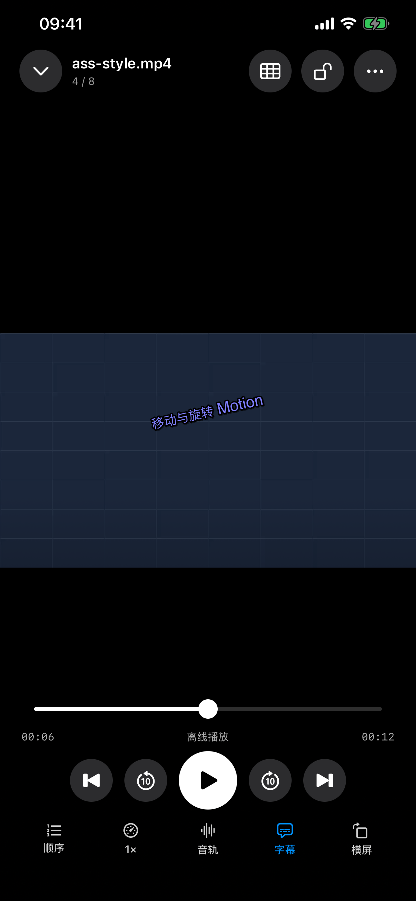

# Glide 1.11.0（4）：ASS 原字体真机复核

2026-10-23。延续[构建 3 原样渲染实现](../Glide-1.11.0-ASSStyle-2026-10-22/README.md)，更新主应用 Glide，使用用户已授权的保存连接复核《绝望主妇》第一季第一集。iPhone 13 Pro Max，iOS 27.0.1。

## 修正与原字体

实片 ASS 有 707 条事件，179,684 字节，指定“文泉驿微米黑”，但媒体字体附件数量为 0。构建 3 首次真机报告确认原字体缺失；补入原字体后，CoreText 的首选英文名称仍导致中文名称被误报为缺失。构建 4 从 SFNT `name` 表读取多语言 family／full／PostScript／typographic／WWS 名称，保留边界检查，并以 libass 实际选择的 PostScript 字体名与已提供字体交集复核，避免只用“字体文件已存在”推断实际显示字体。

从[字体官方项目](https://sourceforge.net/projects/wqy/files/wqy-microhei/0.2.0-beta/)取得 WenQuanYi Micro Hei 0.2.0-beta 原 TTC。SHA-256 为 `e4bca8df123ce01b104780f576ea1a58b9a5ff1662a91124b6d3180cb6c88212`，5,177,387 字节。官方双许可中选择 Apache 2.0，原作者及许可见 [Fonts](Fonts/WenQuanYi-Provenance.json)。字体仅导入当前 Glide 私有字幕字体目录，同时保留许可副本；未注册系统字体，未把字体二进制加入应用包或源码仓库。应用的正常用户入口为“字幕控制 → 导入字幕字体”，支持 TTF／OTF／TTC；本次通过开发设备工具写入同一私有目录，未自动化操作文件选择器。

实际字体别名包含“文泉驿微米黑”“文泉驛微米黑”和 WenQuanYi Micro Hei，等宽 face 的对应名称也已读取。对该实片，最终报告原字体缺失数 0、libass 选中提供字体数 1。原始样式表和覆盖标签直接进入 libass，中文／英文各自的字号、颜色、描边、阴影、位置继续按原脚本绘制。

## 真机结果

[最终脱敏报告](ASS-iPhone-Build4-Final.json)版本为 **1.11.0 (4)**，时间 **2026-10-23 09:02:14（Asia/Shanghai）**。不是旧构建报告。

| 检查 | 结果 |
| --- | --- |
| 指定实片生产路径 | 13／13 通过：原 ASS 选中、完整样式表与覆盖标签、双语正文索引、实际解码时钟定位、真实栅格出现、关闭普通文本叠加、实际选中提供字体、关闭字幕、往返普通文字字幕、暂停保持与继续播放。 |
| 定位 | 目标／实际均为 16.180 秒；恢复播放后实际 17.502 秒。字幕开关与切换复用原视频会话。 |
| 原创特效 | 真机 14／14 通过，含颜色像素、描边／阴影／绘图、透明度／模糊、淡入淡出／卡拉 OK、运动／旋转／变换、裁剪／缩放、暂停复用、结束清屏、回退恢复和色彩矩阵。 |
| 字体 | 请求字体 1，媒体字体附件 0，最终缺失 0，libass 实际选中提供字体 1。 |
| 用户状态 | 两路字幕记忆已恢复；诊断不报告观看进度。已无参数启动普通 Glide，并从设备预览确认回到首页。 |
| 生产界面回归 | 原创 H.264／AAC 素材在 AVPlayer 与 VLC 都通过，覆盖颜色／字体、运动效果、同事件内拖动、关闭／重新开启。最终单项用例内含两种内核，0 失败，见[摘要](UI-Acceptance-Summary.json)。 |
| 核心回归 | 208 项通过：201 Swift Testing＋7 XCTest。新增多语言名称与截断／损坏表边界用例，见[日志](Logs/Core-Font-Aliases.log)。 |
| Release | 构建 4 归档通过，deep／strict 签名有效，Glide 与 MobileVLCKit 的 dSYM UUID 均匹配，发布预检通过。见[符号](Archive-Symbols.json)、[签名](Release-Signature.txt)与[预检](Release-Preflight.txt)。 |

模拟器界面回归与 Release 归档结果见 [Validation.json](Validation.json)。构建 3 的两份字体报告保留为历史过程：首次原字体缺失，补入后中文别名误报；不能据此替代构建 4 的最终证据。

## 验证范围

本次复核指定剧集的原字体、原配色与双语布局；动态特效使用原创脚本做像素及时间验证，不以普通对话片段推断所有特效已穷尽测试。原字体要实际存在于媒体附件、脚本内嵌字体、私有导入目录或系统中；其他片源仍可能需要补入对应字体。字体名称解析依据 [OpenType name 表规范](https://learn.microsoft.com/en-us/typography/opentype/spec/name)。

脚本／字体／缓存尺寸限制以及 PiP、AirPlay、Emby 路线的边界沿用构建 3；未承诺所有来源、所有字体与特效组合完全相同。仅导出已脱敏计数与时间，不导出登录、服务器地址、媒体标识、私有视频或字幕正文。没有上传商店、提交、推送或打标签。

## 界面回归历史

本次三轮失败摘要均保留：[首次](UI-First-Failure.json)、[第二次](UI-Second-Failure.json)、[菜单项坐标点击](UI-Menu-Failure.json)。问题发生于 SwiftUI 原生菜单自动化：菜单控件在 Button／PopUpButton 间分类变化、菜单未完全打开、溢出菜单项的坐标点击未执行选择。最终测试按稳定标识查询任意控件类型，点击快捷菜单可见中心并等待目标项，使用 XCTest 的菜单项 tap 自动滚动到可点击位置，再断言菜单已关闭及真实渲染状态。保留原先渲染／开关断言，没有改生产菜单或跳过失败步骤。

最终仍记录既有的 `_UIReparentingView` SwiftUI 原生菜单运行时提示；未隐藏提示，也不把单项回归视作全部菜单的无缺陷证明。

Release 日志仅记录没有 AppIntents.framework 依赖而跳过元数据提取的提示，归档成功。归档保存在 `/tmp/Glide1110-ASSStyle/Device-2026-10-23/Glide-1.11.0-4.xcarchive`。本次 140 个构建输入的指纹见[源码快照](Source-Snapshot.json)，最终测试与证据索引见[Validation.json](Validation.json)。

以下均为原创测试素材，不包含用户私有视频或字幕：

