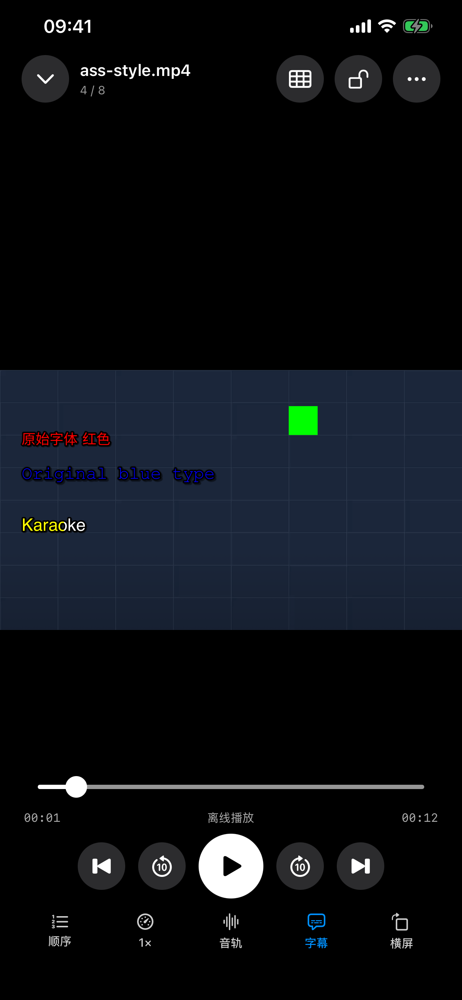
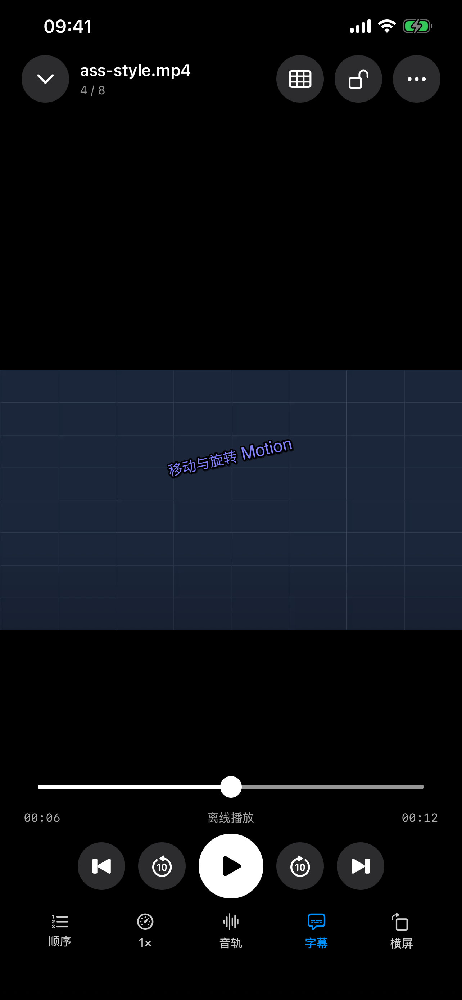

# Glide 1.11.0（3）：ASS／SSA 原样渲染

本页保留构建 3 当时的开发结果与设备连接状态；后续构建 4 已完成指定实片真机复核，见[2026-10-23 最终记录](../Glide-1.11.0-ASSFont-2026-10-23/README.md)。

2026-10-22。此增量按用户要求保留原始 ASS 字体、颜色和特效。开发验证已通过；iPhone 当前连接不可用，尚未更新构建 3，也未完成《绝望主妇》第一季第一集的原样真机复核。构建 2 的文字清理报告是历史结果，不作为本次完整样式通过证据。

## 实现

- Jellyfin 读取当前媒体版本的 `Stream.ass`，把完整脚本交给固定 SDK 内的 libass 0.17.3；保留原始样式表和覆盖标签，不把 SRT 转换结果作为 ASS 画面。
- 读取当前版本 `MediaAttachments` 的字体，经同源认证的附件接口下载；不采用不受信任的字体 URL。字体只供当前渲染器使用，不注册或替换系统字体。ASS 内嵌字体由 libass 直接提取。
- 本地目录、SMB 同名外挂及受管理导入副本支持 UTF-8 ASS／SSA；另保留干净正文索引，供全文、搜索、定位和单句循环使用。绘图事件即使没有正文，也可以播放。
- 字体、颜色、描边、模糊、阴影、定位、绘图、淡入淡出、移动、旋转、变换、裁剪与卡拉 OK 交给 libass。普通字幕外观和底部距离不覆盖 ASS。两路 ASS 保持各自原布局，可能重叠。
- 按实际解码时钟更新；逐帧绘制在独立 actor 中串行执行，字体初始化也串行化，快速选择已取消的请求在初始化前检查取消状态。画面不变时复用栅格。字幕跟随视频矩形和捏合缩放，系统内核的适应／填满使用实际 AVPlayerLayer.videoRect；兼容内核使用其适应模式。
- 使用 libass 的分层顺序和预乘透明度合成；处理 ASS 声明的 YCbCr 矩阵与视频色彩空间。HDR 字幕按 SDR 叠加，未承诺 HDR 下与视频像素精确配色。
- 暂停、时间偏移、拖动与字幕开关保留；Jellyfin ASS／普通文字字幕切换复用视频会话。文件字体未提供时给出提示，可从“字幕控制 → 导入字幕字体”导入 TTF／OTF／TTC。

## 验证

| 项目 | 实际结果 |
| --- | --- |
| 核心回归 | 206 项通过：199 Swift Testing＋7 XCTest，新增 4 项覆盖原始脚本保持、正文／时间索引、字体名称、无效输入边界、ASS 副本持久化。见 [日志](Logs/Core-Final.log)。 |
| 栅格与特效 | 14 项通过，包括运行库版本、6 个原创事件、字体差异、红／绿／蓝像素、透明度／模糊、淡入淡出／卡拉 OK、移动／旋转、逆向裁剪、缩放、结束清屏、后退定位及颜色矩阵。见 [机器报告](ASS-Style-Simulator-Final.json)。 |
| 生产界面 | 原创 H.264＋静音 AAC 样例在 AVPlayer 与 VLC 分别通过；确认原样像素层、关闭普通文本叠加、同一句内拖动、不同特效段定位、关闭／重新开启。见 [最终摘要](Style-UI-Acceptance-Summary.json)。 |
| 文字回退回归 | 原 ASS 控制块保留在 SRT 的样例在两内核通过，确保原有清理路线继续工作；见 [历史批次摘要](Style-UI-Regression-History.json)，该批次同时保留一个无音轨样例首次暂停起播失败。 |
| iPhone | 构建成功，但更新安装被 CoreDevice 4016 拒绝，设备不可用。见 [安装记录](Logs/Device-Install-Unavailable.log)。没有读取旧真机 JSON 冒充本次结果。 |
| Release | 最终归档、deep／strict 签名、应用与 MobileVLCKit dSYM UUID 和发布预检见 [符号](Archive-Symbols.json)、[签名](Release-Signature.txt)、[预检](Release-Preflight.txt)。未上传商店、提交、推送或打标签。 |

模拟器：iPhone 13 Pro Max／iOS 26.3.1。源文件、构建与测试证据指纹见 [验证索引](Validation.json)及[源码快照](Source-Snapshot.json)。界面测试出现既有的 `_UIReparentingView` 系统菜单运行时提示，未关闭警告，也不据此宣称所有菜单均已全面验收。

首轮样式用例误用了旧的滑块标识，并点到卡片文字区域；已按实际生产画面入口及 `player.seekBar` 修正。后续无音轨 MP4 在 VLC“首次启动即暂停”场景未显示首帧；最终 ASS 样例使用 H.264＋静音 AAC，未把此结果描述为修复了所有无音轨文件起播。历史失败保留在 `/tmp/Glide1110-ASSStyle/Style-UI.xcresult` 与 `Style-UI-Final.xcresult`，摘要另存本目录。

## 边界与待验

保留原始字体需要字体文件实际存在：优先使用脚本／媒体字体附件、导入字体和系统字体。缺失时仍会替代并提示，不承诺凭字体名称生成或下载不存在的字形。含 ASS 内嵌字体时由 libass 处理，不以 CoreText 系统字体清单判断其缺失。

脚本上限 2 MB、单字体 20 MB、加载字体总量 64 MB；最多请求 32 个当前媒体版本字体附件。渲染目标最长边 2048 像素，字体／字形和位图缓存有上限。ASS 是应用内画面层，PiP／AirPlay 不包含该层；Emby 继续使用既有服务器烧录路线，未新增 Emby ASS 附件提取，也未声称完成所有来源和字体的矩阵验收。

实体机重新连接后，更新现有 Glide，使用已经授权的已保存连接运行指定剧集验证，检查原始样式表、真实显示像素、字体附件／缺失数量、与普通字幕往返切换、暂停／实际定位及继续播放。探针保护并恢复两路字幕记忆，不上报观看进度；仅导出脱敏计数与时间。

依据：[libass 0.17.3 公共 API](https://github.com/libass/libass/tree/0.17.3/libass)、[Jellyfin 字幕接口](https://github.com/jellyfin/jellyfin/blob/master/Jellyfin.Api/Controllers/SubtitleController.cs)、[字体附件接口](https://github.com/jellyfin/jellyfin/blob/master/Jellyfin.Api/Controllers/VideoAttachmentsController.cs)。原始头文件指纹见 [libass 来源](../../Dependencies/libass-0.17.3-headers.json)，第三方许可保留在应用声明中。

下图为原创测试素材，不含用户私人视频和字幕正文。

