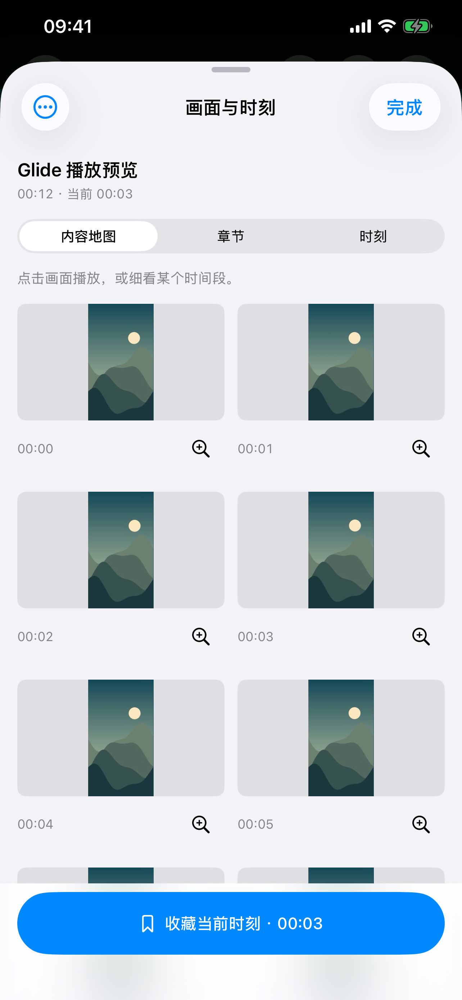
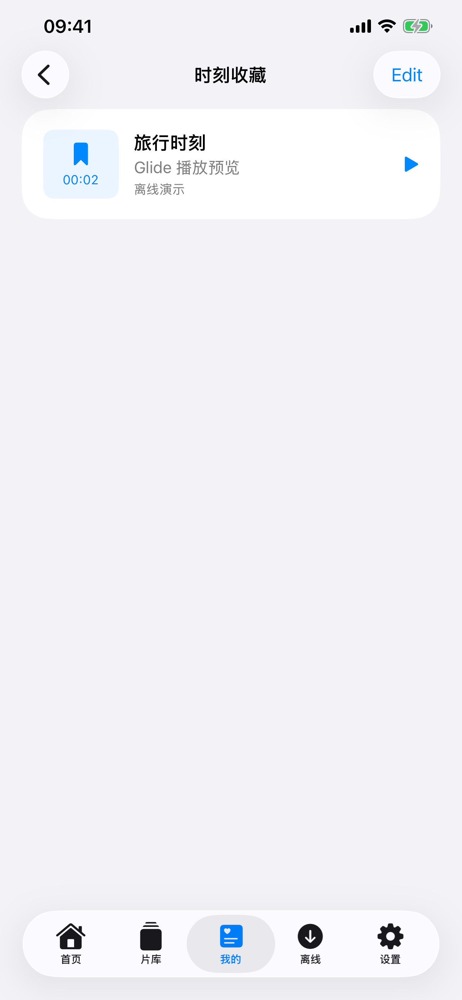
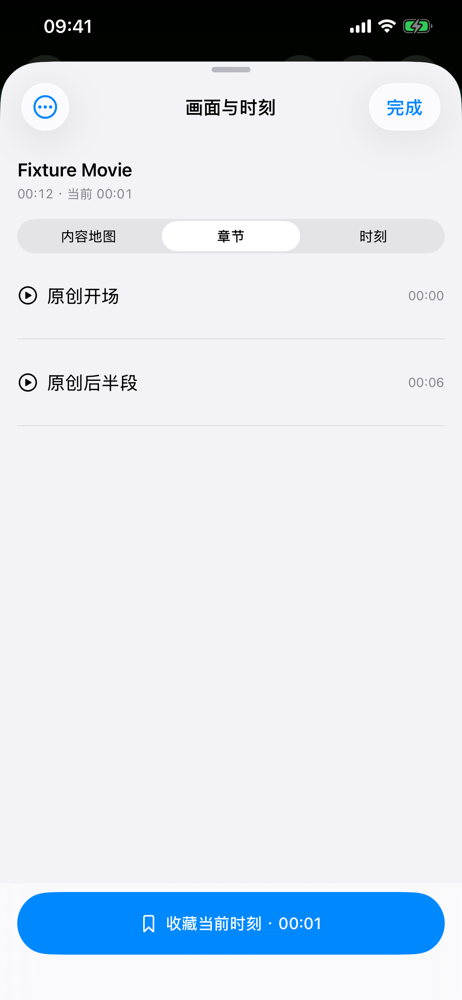

# Glide 1.11.0（1）：内容地图与时刻收藏

2026-10-22。实现视频内容地图、时刻收藏与章节导航。核心测试、模拟器最终用例及真机 14 项原创素材检查已通过；已恢复普通 Glide，Release 归档、签名、dSYM 与发布预检均通过。状态见 [Validation.json](Validation.json)。未提交、推送、打标签或上传商店。

## 已实现

- 播放器直接进入“画面与时刻”，按画面浏览、细化局部时间段、点图播放；打开时暂停视频，关闭后恢复之前的状态。
- 当前页面最多 24 个取样、最多三层细化、最多两个取图任务。使用实际图像时间作为标签与跳转点，磁盘缓存上限 64 MB，支持清理。服务器拼图裁剪后复制成小图，避免每个小预览持有整张大拼图。
- 本地、离线文件使用系统按需取帧；Jellyfin 使用来源已经生成的当前媒体版本 Trickplay，按真实间隔与图块位置读取；无能力时明确提示。已有文件章节与来源章节提供直接定位，默认版本章节不跨剪辑版本套用。
- 保存、命名、搜索、重命名和删除时刻；从“我的 → 时刻收藏”再次播放，重启可恢复。来源账号和文件版本在真正安装播放资源前核对，检测变化时阻止错误跳转。
- 家庭视频关闭历史记录后仍尊重用户手动指定的起播位置，不自动开启历史。

## 实际验证

| 项目 | 结果 |
| --- | --- |
| 核心 | 196 项通过：189 Swift Testing＋7 XCTest，新增 11 项覆盖采样范围／上限、异常片长、跨行跨页精灵图、尺寸边界、版本／账号、章节时间、凭据清理与快照恢复。见 [日志](Logs/Core-Final.log)。 |
| 地图、收藏与生产播放 | 内容地图细化／返回／真实定位／清理缓存，收藏创建／重启恢复／重命名／再次播放／删除，以及原创生产探针分别通过。探针包含真实取帧、实际解码器时间与首帧前版本变化拦截，共 14 项。见 [批次摘要](Navigation-Final-Controls-Summary.json)。该批次的旧服务器用例失败保留，其最终替代见下一行。 |
| Jellyfin 与既有回归 | 3 项通过、0 失败／跳过：Jellyfin 真实图片裁剪与章节定位／收藏／重启／按原版本播放；1.10.0 三段真实视频的频道自动推进；原生导航、菜单和浅色／深色／跟随系统。见 [摘要](Navigation-Server-Regression-Summary.json)。最终六个独立界面用例均已取得通过结果。 |
| 实体机 | iPhone 13 Pro Max／iOS 27.0，最终包 1.11.0（1）14 项检查通过。实际生成画面时间 6 秒、真实解码器恢复时间 6 秒、实际 seek 到 2 秒，文件版本变化在首帧前拦截。报告时间为 2026-10-22 17:51:05（北京时间）；已恢复普通 Glide。见 [脱敏报告](Navigation-iPhone-Final.json)、[启动](Logs/Device-Probe-Launch.log)和[恢复](Logs/Device-Normal-Launch.log)。仅原创素材与隔离收藏文件，不读取私人服务器。 |
| Release | 最终源码归档、deep／strict 签名、发布预检及应用／MobileVLCKit 的真实 dSYM UUID 均通过。见 [预检](Release-Preflight.txt)、[签名](Release-Signature.txt)、[符号](Archive-Symbols.json)和[构建指纹](Build-Manifest.json)。本机归档未上传商店。 |

模拟器为 iPhone 13 Pro Max／iOS 26.3.1。服务器只监听 127.0.0.1:8768，使用原创 MP4 与模拟账号；完成后已停止。Jellyfin 测试证明客户端契约，不替代用户 NAS 或真实 Jellyfin／Emby 服务器的全格式验收。SMB／WebDAV 的新时刻版本信息读取尚未执行真实 NAS 矩阵。没有重新执行所有历史字幕、4K、弱网、长播、AirPlay 等专项；不声明实体机触控自动化通过。

## 发现与修正

首轮 [2 通过／2 失败](Navigation-Initial-Summary.json)：放大镜按钮的空白触控区域没有命中，已补全 44 点矩形区域；底部收藏入口改为固定文字按钮，避免被工具栏收成单图标。两项 [修正复测通过](Navigation-Fix-Summary.json)。

服务器测试还遇到旧目录恢复状态不一致：[旧批次](Navigation-Verified-Summary.json)停在已经打开的电影库，修正为识别目录与影视库的返回入口。后来 [Controls 批次](Navigation-Final-Controls-Summary.json)在章节 seek 尚未结束时过早再次操作导航；最终服务器用例等待实际定位结束后再打开，完成收藏与重启恢复，见上述 Server-Regression 摘要。历史失败与最终通过分别保留。

最终编译期间有一次新增代码跨 actor 读取蜂窝播放偏好的错误，改为异步读取后重新编译通过；没有关闭警告。最终运行中原先由底部工具栏触发的 UIKitToolbar 警告已消失。Release 只有未依赖 AppIntents 而跳过元数据提取的提示。签名首次在沙箱内返回 CSSMERR_TP_NOT_TRUSTED，保留 [记录](Release-Signature-Sandbox.txt)；相同归档在完整本机环境验证通过，没有修改证书或重新签名。

## 边界

时刻保存稳定身份、账号、版本元数据和时间，不保存解析后的播放 URL 或认证头。版本校验不是整文件哈希，无法证明相同大小／时间等元数据的文件内容完全相同。动态播放链接没有可靠文件版本时不支持保存；SMB 依赖大小与修改时间，WebDAV 依赖 ETag 或 Last-Modified。最多 1000 个时刻；删除收藏不删除视频。当前不包含跨设备同步、中文自然语言画面搜索或剧情／人物识别。

界面截图只含原创素材和模拟服务器内容：

[体验步骤](User-Acceptance.md)、[产品范围](../../Glide-1.11.0-Product-Plan-2026-10-22.md)、[发布说明](../../Glide-1.11.0-Release-Notes.md)、[源码指纹](Source-Snapshot.json)。
