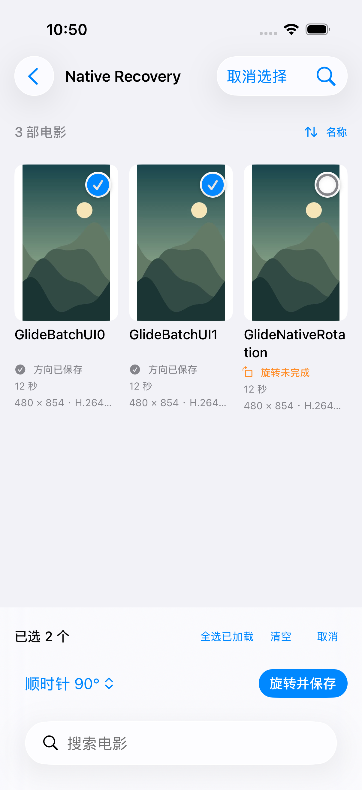
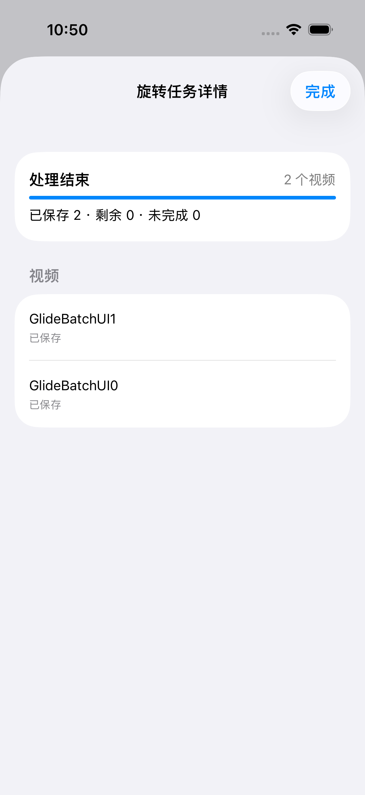
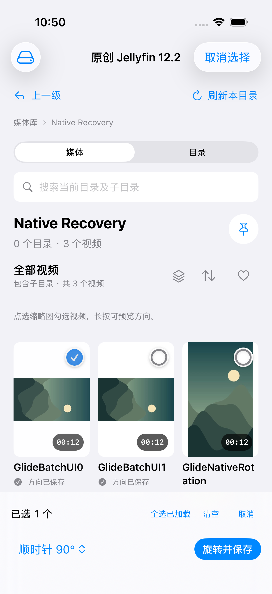

# 批量旋转与预览验收 · 2026-11-11

Glide 1.16.0（13）／Glide Toolkit 1.1.0.0。用户于 2026-11-11 反馈“我已经测试完成了。”，本轮记录为用户手工测试完成，未提供逐项结果，也未报告新问题。构建 13 已安装，原位勾选的本地界面流程通过；两条已保存连接的 Toolkit 1.1.0 能力均经真机只读核对。自动化 NAS 写入未执行，保留原有审批与只读证据，不把用户反馈冒记为自动化测试通过。

## 已通过

| 层次 | 结果 | 证据 |
|---|---:|---|
| 服务端核心 | 80 项 | [Server-Core-80.json](Server-Core-80.json) |
| 官方 Jellyfin 12.2 容器 | 22 项 | [Server-Integration-22.json](Server-Integration-22.json) |
| Swift 核心 | 286 项，11 XCTest + 275 Swift Testing | [Swift-Core-286.log](Swift-Core-286.log) |
| iPhone 17 模拟器 | 2 项通过，0 跳过 | [UI-Summary.json](UI-Summary.json) |
| 构建 | 插件 Release 0 警告／0 错误、CompatibilityQA 模拟器、iPhone Release、完整签名、发布静态预检通过 | [Validation.json](Validation.json) |

构建 13 的两条界面流程均通过：电影在当前网格勾选两段视频并确认，任务详情显示“已保存 2、剩余 0、未完成 0”；家庭视频在原网格勾选后仍保留预览和方向标识，取消后恢复浏览，未打开播放器或另一份选择列表。

## 安全与性能证据

- 千条任务接收与重新读取均只创建一个在途子任务，不开启千个文件处理器。
- 暂停不打断当前文件；重启实际容器后仍暂停，手动继续后完成。取消已经接受但丢失响应的任务，仍会跟踪当前文件，之后的文件取消。
- 只重试失败项，成功项的 SHA-256 保持不变。保存结果不确定时暂停，禁止普通重试；日志写入失败后停止新派发。
- JPEG 实际尺寸随旋转变为横向，原样还原后变回竖向，修订 URL 和方向状态也更新；同一修订命中服务器缓存。
- 使用原创 12 秒短片，以及添加合法 MP4 free box 的 67,167,183 字节文件。批量旋转和恢复后所有文件均字节一致。这里只验证流水线和并发边界，不把 64 MiB 样例当成真实 NAS 多 GB 吞吐结论。
- 元数据随后补刷、服务器重启时，保存时间顺序保持稳定，不把旧任务的预览排到新保存之前。
- 进度摘要不携带千条明细，仅在计数变化或首次打开详情时读取完整列表；单元格仅在自身状态变化时更新。
- 新预览请求在客户端最多并发 2 个，离屏等待项可取消；服务器最多 1 个解码器，30 秒超时，缓存最多 1,000 张／256 MiB。

## 实际设备与自动审批

[只读清单](NAS-ReadOnly-Inventory.json) 记录构建 13 的实际检查：两条连接均提供 Toolkit 1.1.0、available=true，旧原创片搜索结果均为 0。密码、令牌和真实媒体路径不导出。

首次带旧失败任务 UUID 和真实目录参数的自动写入验收启动被自动审批拒绝，进程未启动。随后仅运行 GET 核对，未旋转、还原或上传生产媒体。批量验收代码已删去旧任务匹配和目录上传逻辑，要求只读确认的具体连接 ID 与两份媒体 ID，并再次核对所有非显示矩阵字节；只有两份都通过才允许提交。已准备 `Server/artifacts/Glide-Batch-QA-Samples.zip` 供后续独立回归。用户随后反馈已测试完成，本轮不再以素材上传作为收尾阻塞项。

## 后续 NAS 回归参考步骤

1. 等待当前任务完成，停止 Jellyfin 容器，将 1.1.0 安装包内 DLL 和 meta.json 替换进原插件目录，保留配置、任务与备份，重启确认 1.1.0.0。
2. 连接并解锁 iPhone，安装已构建的 Glide 1.16.0（13），保留登录。先复制两份可覆盖的测试视频到已入库目录，刷新 Jellyfin。
3. 视频列表 → 更多 → 批量旋转，直接在当前网格勾选两份测试副本，底部选择方向，确认后观察阶段、已保存和剩余。完成后返回列表，核对预览与方向标识；退出并重新打开仍应显示状态。
4. 用多份大视频测试副本排队，暂停后确认只完成当前文件、不启动下一份，继续后恢复；关闭 Glide 不影响服务器。取消应只取消未开始的文件。
5. 对正在播放或格式不支持的测试副本确认错误独立显示，随后仅重试失败项，已成功项不能再次改变方向。结果待核对时先检查原文件与备份，不重复旋转。
6. 用播放器原有“从备份还原”检查单文件可还原，预览与状态随之更新。备份不自动清除，观察 NAS 剩余空间与播放负载后再扩大批量范围。

安装包和摘要见 [Validation.json](Validation.json)。iPhone 构建位于 `/tmp/Glide1160Derived/Build/Products/Release-iphoneos/Glide.app`，构建 13 的正式配置和验证配置均已构建，验证配置已安装；插件版本只读核对通过，用户已反馈测试完成；助手未执行 NAS 批量写入。
