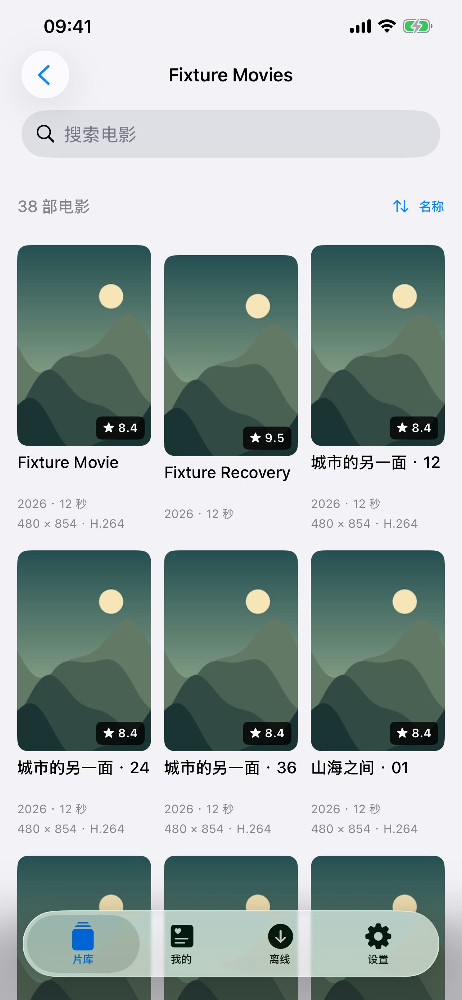
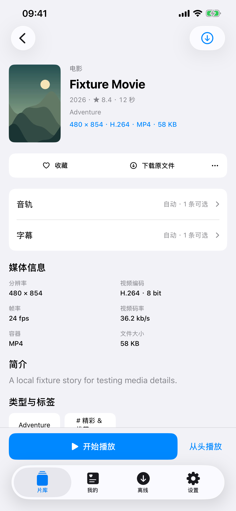
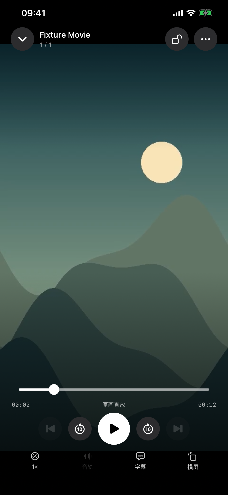

# Glide 1.9.0（5）：原生外观与交互走查

2026-10-21。按“尽量与苹果原生应用保持一致”调整。本轮使用实体机屏幕预览、源码检查和模拟器触控回归。实体机 XCTest 在启动测试用例之前以 code 74 退出，完整真机触控走查尚未验收。此记录不代表发布批准。

## 设计与已实现改动

- 默认跟随系统外观，在设置中提供“跟随系统／浅色／深色”。文字、分组背景、面板、分隔线使用系统语义颜色；主要操作使用系统蓝。
- 恢复标准导航栏与标签栏的系统材质和行为，不再强制深色导航背景。播放器单独保持深色，主要播放键和进度使用白色。
- 底部入口为“片库／我的／离线／设置”；“我的片库”内部继续提供“继续观看／我的收藏”。移除电影片库顶部重复的设置和离线按钮。
- 来源与目录首页使用系统导航栏：左侧切换媒体来源，右侧“更多”打开链接与固定目录；标题显示当前来源，避免只有图标而丢失来源上下文。
- 设置恢复系统分组表单与正文尺寸；媒体网格继续使用紧凑标题、次要信息和竖版预览图。
- 海报评分、视频时长使用独立白字深底，避免浅色模式继承黑字导致不可读；连接按钮的忙碌指示器使用白色。

设计依据：[Apple Color](https://developer.apple.com/design/human-interface-guidelines/color)、[Dark Mode](https://developer.apple.com/design/human-interface-guidelines/dark-mode)、[UIKit 动态颜色](https://developer.apple.com/documentation/uikit/supporting-dark-mode-in-your-interface)。使用系统组件以继承当前系统的外观与交互，没有额外仿制一套玻璃材质。

## 问题记录

| 编号 | 证据来源 | 问题与影响 | 处理状态 |
| --- | --- | --- | --- |
| UI-01 | 真机旧片库画面＋源码 | 全应用强制深色与固定薄荷绿，无法遵循系统外观 | 已改为动态颜色、系统蓝与外观选项；实体机已查看构建 5 中间预览包的浅色媒体库、浅／深色设置；最终包待更新复核 |
| UI-02 | 真机旧电影列表＋源码 | 顶部设置／离线与底部入口重复，占用片库注意力 | 已移除顶部重复入口；交互回归见下 |
| UI-03 | 真机目录根页＋源码 | 自定义页头同时堆放品牌、来源、链接与固定入口，层级分散 | 已采用原生导航栏及更多菜单，保留来源上下文 |
| UI-04 | 真机标签栏＋源码 | “继续与收藏”作为标签名过长 | 已改为“我的”，页面标题为“我的片库” |
| UI-05 | 源码颜色适配检查 | 评分和时长暗底可能继承浅色文字色，连接忙碌指示器为黑色 | 已修正覆盖文字与指示器颜色；浅色原创媒体截图可核对 |
| UI-06 | 源码检查 | 根视图统一覆盖文字前景色，使原生组件难以自行选择主次文字 | 已移除全局前景覆盖，组件按系统或局部语义色显示 |
| UI-08 | 模拟器运行采样 | 密集片库测试中主线程持续处理 SwiftUI／UIKit 外观 trait 更新，CPU 约 90%；无法据此判断真机帧率 | 单独简化颜色未消除问题。将电影页外层 LazyVStack 改为 VStack，保留内部 LazyVGrid 懒加载后，同场景滚动与详情返回测试通过；同样调整目录及相关作品容器，最终源码滚动、媒体布局与目录流程均已通过 |
| UI-07 | 测试基础设施 | 真机触控服务在测试 bootstrap 前断开，不能测连续滑动、返回手势及单手操作手感 | 未解决；用户开启 UI 自动化、USB 重连及释放旧工具会话后仍复现；不按通过记录 |

## 验证范围

实体机：iPhone 13 Pro Max、iOS 27.0、主应用 Glide。早期配色预览包已更新到主应用并保留原有连接；最终界面构建在重新安装时设备离线，尚待更新。使用 DEBUG 启动参数展示指定页，外观覆盖只存在于该进程，不写入外观设置；这不等于真实点击完成了该导航。审查模式禁用播放器观看进度上报。原始截图与测试包保存在 `/tmp/Glide190/UIAuditPrivate/` 等本机临时路径，未纳入 Git。

模拟器：使用原创回环媒体服务，测试更多菜单、固定目录、外观选择、详情主操作、音轨可用性、字幕及倍速菜单、播放设置、密集片库滚动及返回位置。密集片库与媒体详情／播放控制已在最终应用源码通过；目录范围与固定入口补测通过。不把模拟器结果表述为真机触控或真机帧率。

还需在触控通道恢复后用实体机复核：连续滚动、边缘返回、横竖屏切换、播放时呼出音轨与字幕菜单、外观切换后的返回状态和较大字号。当前没有采集真机 Instruments 帧率／掉帧数据，不宣称已解决所有滑动卡顿。

构建 4 的 PGS 与音轨验收文件保持冻结；本次改动不沿用旧包验收作为新包通过证据。

## 已核对的界面截图

以下仅含原创素材和模拟器测试账号。电影详情将媒体参数独立分组，主播放操作留在底部；播放页保持深色与白色主要控件。原始真机截图含用户片库，保留在本机临时目录，不放入仓库。

## 验证限制与失败保留

真机触控连续 7 次均在测试用例启动前断开，报 `The test runner exited with code 74 before establishing connection`。这是本轮未能完成真机交互验收的具体阻碍，不能算作应用业务测试通过或应用崩溃。

首轮模拟器测试中，菜单用例失败，滚动用例因持续主线程活动被中止。仅简化颜色未消除滚动问题；改为单层懒布局后，外观与密集滚动两项通过。最终源码首批媒体布局与密集滚动通过；菜单及目录流程早期点击失败已保留，随后针对系统控件的类型定位和菜单打开时序补测。各轮摘要均保留，不以最后一次通过掩盖早期失败。

当前未重新生成 Release 归档；本地发布静态预检通过。构建 4 的归档与真机 PGS／音轨结果属于旧包，不代替本次验收。

## 最终结果

四项独立 UI 用例在相同最终应用源码上分别通过：外观与导航、38 项密集片库滚动、媒体详情与播放控件、目录范围／排序／固定。菜单定位与打开时序调整只涉及测试程序；失败批次仍保留在摘要中。详见 [验证状态](Validation.json) 及 [源码指纹](Source-Snapshot.json)。

滚动记录确认遍历 38 个不同媒体卡片、两次详情访问复用元数据及海报缓存、返回后保持选中行。测试服务在前一轮已送出首张海报，因此这次没有观测到首张海报的完整等待阶段，不把帧位置断言表述为完整冷加载性能测量。

最终 Debug 真机包构建及发布静态预检通过；手机已离线，最终包尚未更新安装。请重新连接并解锁后继续安装与实体机视觉复核。完整真机触控仍待解决测试通道 code 74 后验收。本轮没有 push、打 tag 或上传商店。

最终设置外观截图：[浅色](Screenshots/Settings-Light.png)、[深色](Screenshots/Settings-Dark.png)。滚动原始测量见 [Scroll-Measurements.json](Scroll-Measurements.json)，完整尝试记录见 [Attempt-History.json](Attempt-History.json)。
