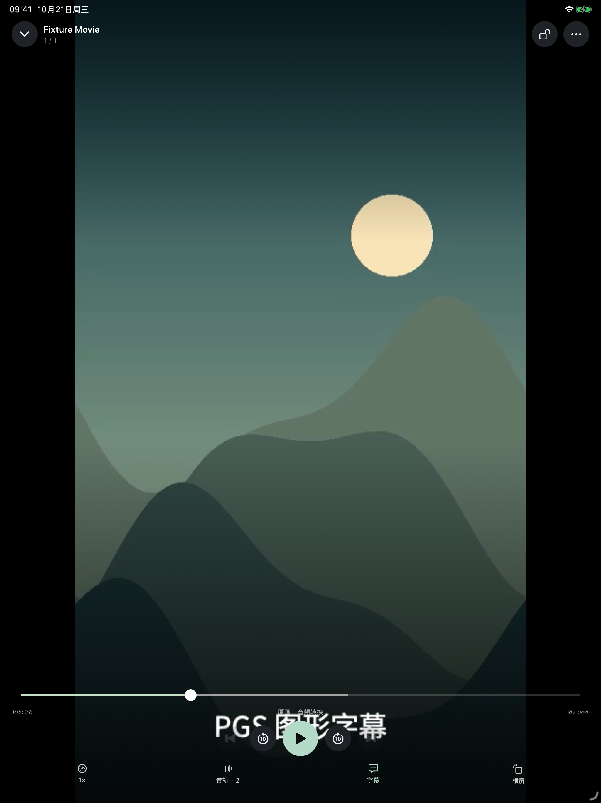

# Glide 1.9.0（4）：PGS 与播放中音轨切换

2026-10-21 完成实现、定向真机复核和 Release 归档。修复包已安装到主应用 Glide，并正常打开。此记录覆盖两个回归，不代表所有来源、格式及长时间播放均已验收，尚未提交商店。

## 原因与改动

旧实现把 PGS 图形字幕交给服务器烧录，选择后会重新进入视频转码。这集此前的转码路径曾在首帧前失败。现在 Jellyfin 的 PGS 单独提取为原始 SUP，在客户端按播放时间叠加；视频保持原来的播放会话。文字字幕、PGS、关闭及重新启用可以互相切换，保留轨道选择与时间偏移。

音轨菜单之前只读 AVPlayer 当前流中的音轨；服务器输出的 HLS 往往只有一条，原文件的其他音轨因此不可见。现在保留同一媒体版本的完整 Audio MediaStreams，菜单显示数量及实际轨道编号。切换向 PlaybackInfo 传递 MediaSourceId 与 AudioStreamIndex，重新准备音频流并恢复位置和播放／暂停意图，保留字幕选择。

PGS 的压缩数据只保存在会话内存中，单轨上限 64 MiB；最多 4096×2160 画布。解析分段对象、调色板、透明度、裁剪、窗口、显示清除及 90 kHz 时间戳；当前字幕图像在后台按需解码，切换或关闭取消旧任务。异常数据不越界分配，读取失败保留已有字幕并提示。PGS 保留原始排版，不提供文字全文、OCR 或文字样式变换。

接口依据：[Jellyfin SubtitleEncoder](https://github.com/jellyfin/jellyfin/blob/master/MediaBrowser.MediaEncoding/Subtitles/SubtitleEncoder.cs) 的原始格式返回与 SUP 提取约定；PGS 数据布局核对了 [FFmpeg 的公开解码实现](https://github.com/FFmpeg/FFmpeg/blob/master/libavcodec/pgssubdec.c)。应用使用独立的 Swift 有界解析与绘制实现。

## 验收

| 项目 | 结果 |
| --- | --- |
| 核心测试 | 166 通过：159 Swift Testing、7 XCTest，包含 6 项 PGS 时间／图像／异常输入测试 |
| 最终 UI 批次 | 3 通过、0 失败、0 跳过：PGS 与音轨、文字字幕切换、官方 Emby 生产探针 |
| 双字幕回归 | 同一应用源码的独立探针通过；所在批次的两个 UI 点击失败保留在尝试记录，随后最终批次通过 |
| 真机 | iPhone 13 Pro Max、iOS 27、主应用 1.9.0（4），Jellyfin 12.2.0 的已授权原片 |
| 字幕真机检查 | 原文件 12 条字幕，9 项文字字幕切换检查通过 |
| PGS 与音轨真机检查 | 11 项通过：图像实际生成、暂停定位、关闭重开、切换后保留图像、两向音轨切换、重开恢复及切回文字 |
| PGS 实际数据 | 21,253,852 字节、955 条图形显示记录；定位时生成了实际图像层 |
| 实际音轨 | 原文件 2 条 E-AC-3：英文 index 1、中文 index 2；验证最终请求的 AudioStreamIndex 与所选一致 |
| 视频输出证据 | 解码帧 3840×2160、hvc1、PQ／BT.2020，原画加音频转换；未重新烧录 PGS |
| Release | 归档成功、发布静态预检通过、严格签名通过、应用及 MobileVLCKit dSYM UUID 覆盖通过、QA 入口未包含在发布二进制 |

最终真机记录时间为 2026-10-21T08:57:54Z，测试只使用短片段，不写入观看进度；结束后恢复了主、第二字幕记忆。默认首帧 6.82 秒，带 PGS 重开并定位的首帧 18.48 秒；字幕提取与重新准备音轨存在加载耗时，未宣称无缝切换或整集不卡顿。

原创 UI 素材使用实际 SUP 图形和 440／880 Hz 两个不同音频流。服务计数确认两条 HLS 和 PGS 提取端点都被请求。下图仅含原创素材；已人工核对中文字形、方向、位置及第二音轨选择。

## 复测与范围

在 Jellyfin 视频播放页，点底部「字幕」选择 PGS，等待读取后确认图像出现；暂停后拖到有对白的位置，关闭并重新选择。点「音轨」切换不同语言，确认位置与暂停／播放状态保留，再反向切换。文字字幕仍可从同一列表选择。

本轮验证的 PGS 来源是 Jellyfin 12.2.0，服务器须允许提取原始轨道。Emby 图形字幕仍走服务器处理；本地／SMB 的兼容内核路径未改。客户端字幕叠加只在应用画面显示，未宣称 PiP／AirPlay 字幕支持或所有 Dolby Vision 显示模式通过。

源码指纹见 [Source-Snapshot.json](Source-Snapshot.json)，最终真机结果见 [Production-iPhone-Final.json](Production-iPhone-Final.json)，测试与早期失败见 [Attempt-History.json](Attempt-History.json)，总验收清单见 [Build-Validation.json](Build-Validation.json)。归档位于 `/tmp/Glide190/Glide-1.9.0-4.xcarchive`；未 push、打 tag 或上传分发。旧构建 1、2、3 的验收证据保持原样。
